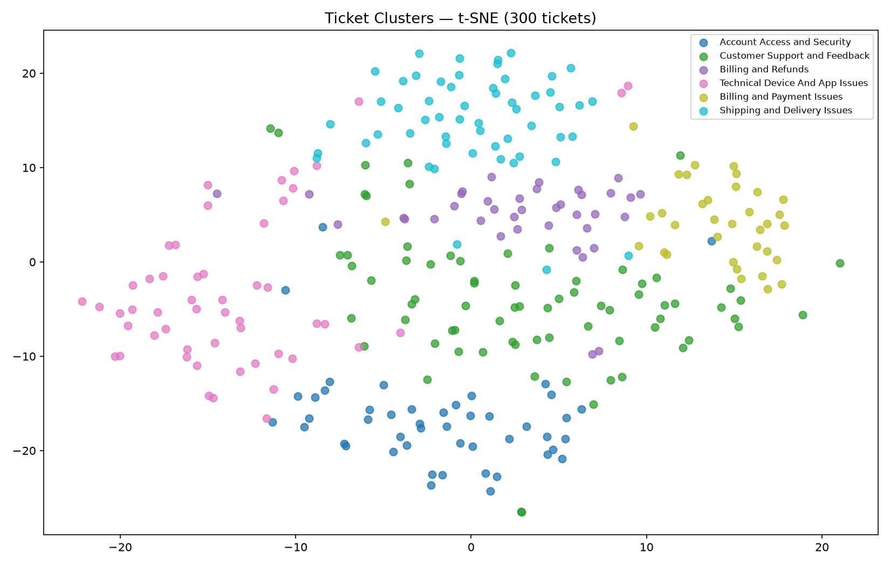

# Результати: Автокатегоризація тікетів через Embeddings

> Числа скрипт друкує сам: вставляйте блоки з консолі як є, нічого не переписуючи в таблиці. Власноруч ви пишете лише відповіді на питання, по 1–3 речення з посиланням на свої числа.
>
> Запуски:
> 1. `uv run starter.py --quick` — подивіться блок `ARI by k` і оберіть k.
> 2. `uv run starter.py --clusters <ваше k>` (з `OPENROUTER_API_KEY`, щоб кластери отримали назви від LLM) — з нього всі блоки секцій 1–3.
> 3. Бонус: `uv run starter.py --quick --rerank --clusters <ваше k>`. `clusters.png` перезаписується при кожному запуску, тому передавайте те саме k.

---

## 1. Кластеризація

Блок **`ARI by k`**:

```text

```

**Яке k ви обрали і чому?** Де пік ARI, і що відбувається з кластерами при меншому та більшому k (які категорії зливаються або розпадаються)?

_(1–3 речення)_



Блок **`Cluster Summary`** (з назвами від LLM):

```text

```

---

## 2. Пошук: 5 демо-запитів і Ticket Helper

Блок **`Summary — avg over all demo queries`**:

```text

```

Блок **`Ticket Helper`**:

```text

```

---

## 3. Leave-one-out на 300 запитах

П'ять демо-запитів показують, **як** поводиться кожен метод, але їх замало, щоб сказати, **який кращий**. Leave-one-out робить кожен з 300 тікетів запитом, а релевантними вважає інші тікети тієї ж категорії. Вердикт «no measurable difference» означає, що інтервал різниці містить нуль. Це повноцінний результат, а не провал.

Блок **`Leave-one-out over all 300 tickets`**:

```text

```

---

## 4. Висновки

**1.** На якому з 5 демо-запитів BM25 і cosine розійшлися найбільше і чому (збіг слів чи зміст)? Чи підтверджує це leave-one-out?

**2.** Fusion RRF: що показує summary 5 демо-запитів і що показує leave-one-out? Чому висновок з 5 і з 300 запитів може відрізнятися?

**3.** Чому Qdrant `:memory:` дає ті самі результати, що й cosine numpy? І чому в production все одно береться Qdrant, а не numpy?

_(1–3 речення на питання)_

---

## 5. Бонус: hybrid + rerank на 90 розмічених запитах

`uv run starter.py --quick --rerank`. Корпус: 300 тікетів + 40 з ідентифікаторами. Запити: 40 exact (з ідентифікатором) і 50 semantic. Деталі в `task.md`.

Блок **`Bonus: 90 labeled queries`** з токенізацією `split()` (як у TODO 4):

```text

```

Той самий блок після заміни токенізації на regex (див. `task.md`):

```text

```

**1.** Де Fusion RRF виграє в cosine, а де програє, і що змінила токенізація? Підказка: порівняйте токени запиту `any update on order #48213?` і тікета `My order #48213 is two weeks late...`. Що це означає для висновку «Fusion ≈ Cosine» із секції 3?

**2.** Де reranker'и допомагають, а де ні? Чому cosine плутає `#48213` і `#48231`, а cross-encoder — рідше? Чому не всі моделі покращують semantic-запити (на яких даних вони тренувались)?

**3.** Що б ви поставили в production для цього helpdesk: Fusion, rerank чи обидва? Врахуйте latency і рядок `Stage 1`.

_(1–3 речення на питання)_

---

## 6. Бонус: свій запит

`uv run starter.py --query "ваш запит"`. Вставте блок цього запиту:

```text

```

Чому BM25 і cosine дали саме такі результати? _(1–3 речення)_
